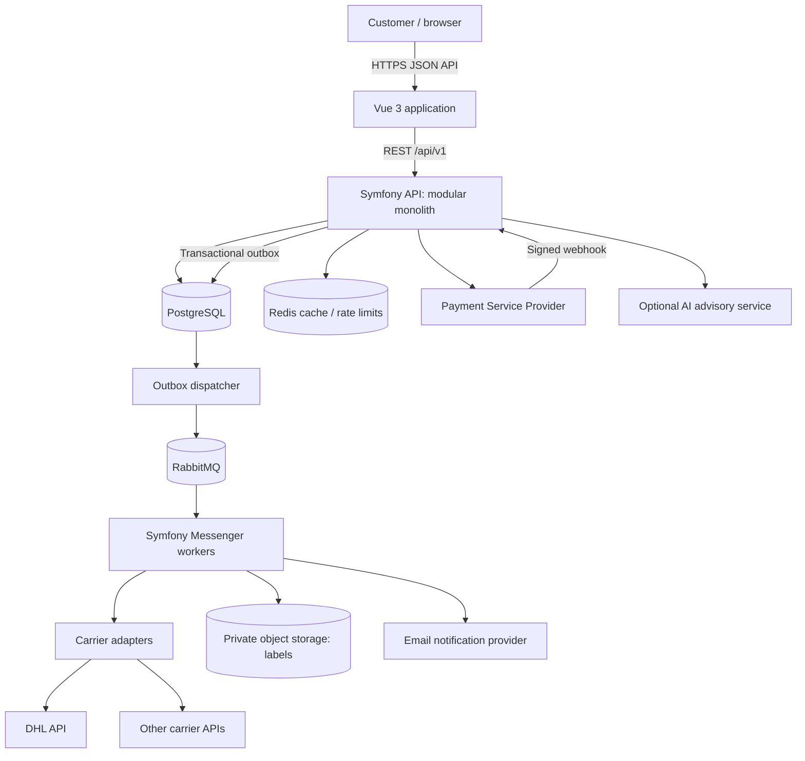

# Shipwise AI — Software Architecture Document

**Version:** 1.0  
**Status:** Proposed / architecture blueprint  
**Architecture style:** API-first modular monolith, DDD-inspired bounded contexts, hexagonal dependencies, asynchronous workflows.

## 1. Context and business model

Customers describe a parcel shipment and compare applicable transport offers. Shipwise presents its own customer selling price based on a provider rate or an agreed tariff, commercial margin, fees and applicable tax rules. The customer purchases from Shipwise. After the payment has been confirmed, Shipwise creates a shipment or purchases a label via an authorized carrier account, stores the resulting label, and shares it with the customer. Tracking and after-sales operations follow.

The exact merchant-of-record, contractual and invoicing model must be confirmed before go-live. Carrier API access is not equivalent to permission to resell shipping services. Carrier account ownership may be Shipwise-owned or merchant-owned depending on the provider agreement.

### Core invariants

1. The browser never receives carrier or payment-provider secret credentials.
2. Final customer charges are calculated and validated by the backend, never trusted from the browser.
3. Every confirmed customer order references an immutable offer/price snapshot, an eligibility decision and a quote expiry.
4. A shipment purchase is attempted only for an order confirmed paid by a verified PSP event or authoritative PSP query.
5. Replayed messages, double-clicks and duplicate webhooks must never create double charges or two shipment labels for the same business purchase.
6. An unknown response after an external purchase must trigger **reconciliation**, not blind retries.
7. Each shipment belongs to an authorized account/customer; every access is checked server-side.
8. Provider prices and customer prices are stored separately. Store money as integer minor units plus currency; specify whether amounts are net or gross.
9. A carrier's label-creation event and physical acceptance of the parcel are different business milestones.

## 2. Context diagram



**Deployment**: reverse proxy/TLS → separately built Vue static application and Symfony HTTP app; independently deployed workers, PostgreSQL, RabbitMQ, Redis, object storage. Local development uses Docker Compose. No Kubernetes requirement for the first release.

## 3. Technology decisions

| Concern | Chosen option | Reason |
|---|---|---|
| PHP framework | Symfony 7.4 LTS, PHP 8.4 | Stable support and strong DI/testing ecosystem |
| Frontend | Vue 3 + TypeScript + Vite + Tailwind | Typed SPA with clean API boundary |
| Persistence | PostgreSQL + Doctrine | Transactions, uniqueness constraints, migrations |
| Messaging | Symfony Messenger + RabbitMQ | Retries, isolated async operations, failure queue |
| Cache | Redis | Rate limits, short-lived derived data; not the system of record |
| API | Versioned REST/JSON, OpenAPI 3.x | Consumer-driven contract and generated client types |
| Payments | PSP adapter, e.g. Stripe | Hosted checkout or payment primitives; no card storage |
| Labels | Private S3-compatible storage | Durable binary documents and controlled download |
| CI | GitHub Actions | Static analysis, tests, dependency and secret scanning |
| Observability | Structured logs, trace IDs, metrics, error reporting | Troubleshoot cross-system workflows |

For DDD-heavy write operations use explicit controllers/DTOs/handlers rather than generic CRUD writes; optionally use API Platform for documented read resources.

## 4. Bounded contexts / Symfony modules

| Module | Responsibility | Principal entities / VOs |
|---|---|---|
| Identity | Customer accounts, roles, access, carrier-account ownership | User, Organization, Membership |
| CarrierCatalog | Carriers, products, coverage, contract capabilities | Carrier, Product, CarrierAccount, Capability |
| Quoting | Parcel input, eligibility, available tariffs, ranking | Quote, QuoteOption, Parcel, Address |
| Pricing | Margins, surcharges, currency/tax calculations | PricingRule, Money, PriceBreakdown |
| Ordering | Immutable accepted offer, customer-facing order | Order, OrderLine, OrderStatus |
| Payments | PSP intents/events, refunds, financial state | Payment, Refund, WebhookInbox |
| Fulfillment | Carrier creation, label document, purchase reconciliation | Shipment, CarrierPurchaseAttempt, Label |
| Tracking | Provider status updates, timeline | TrackingEvent, DeliveryStatus |
| Notifications | Outbound transactional messages | Notification, Template |
| Operations | Admin actions, complaints, manual recovery and audit | AuditEntry, ReconciliationCase |
| AIAdvisor (optional) | Parse natural-language preferences; explain ranking | RecommendationExplanation |

**Dependency rule**: Domain contains rules and value objects and does not depend on Doctrine, Symfony controllers, HTTP clients or provider SDKs. Application handles use cases. Infrastructure implements ports. Presentation maps HTTP input/output to commands/queries. Between modules use explicit application interfaces/domain events, not another module's Doctrine repository.

### Example backend layout

```text
apps/api/
  src/
    Shared/{Domain,Application,Infrastructure}/
    Quoting/{Domain,Application,Infrastructure,Presentation}/
    Pricing/{Domain,Application,Infrastructure,Presentation}/
    Ordering/{Domain,Application,Infrastructure,Presentation}/
    Payments/{Domain,Application,Infrastructure,Presentation}/
    Fulfillment/{Domain,Application,Infrastructure,Presentation}/
    CarrierCatalog/{Domain,Application,Infrastructure,Presentation}/
    Identity/{Domain,Application,Infrastructure,Presentation}/
    Tracking/{Domain,Application,Infrastructure,Presentation}/
    Operations/{Domain,Application,Infrastructure,Presentation}/
  config/
  migrations/
  tests/{Unit,Integration,Contract,Functional}/
apps/web/
  src/{app,router,shared,features,components,stores}/
  tests/{unit,e2e}/
packages/api-contract/
  openapi.yaml
  generated-types/
infra/{docker,deploy,monitoring}/
docs/{adr,ARCHITECTURE.md,threat-model.md,runbooks/}
.github/workflows/
```

## 5. Carrier integration — ports and adapters

```php
interface CarrierGateway
{
    public function carrierCode(): string;
    public function capabilities(): CarrierCapabilities;
    public function quote(ShipmentDraft $draft): CarrierQuoteResult;
    public function createShipment(ShipmentPurchaseRequest $request): ShipmentPurchaseResult;
    public function cancelShipment(ProviderShipmentId $id): CancellationResult;
    public function getTracking(ProviderShipmentId $id): TrackingResult;
}
```

This is an **illustrative interface**: specific operations may be unsupported or quote data may instead come from negotiated tariffs. Capability flags must explicitly state `canQuoteLive`, `canCreateLabel`, `canCancel`, `canTrack`, `canArrangePickup` and supported origin/destination/service restrictions. Unsupported operations return a typed unsupported-capability result, not fabricated information.

Concrete adapters (`DhlCarrierAdapter`, `DpdCarrierAdapter`, etc.) translate Shipwise domain commands into provider-specific payloads, auth flows, error types and identifiers. Providers must be tested with sandbox/fixtures and independently configurable timeouts, circuit breakers, rate limits and credentials. Use stable merchant/carrier references for reconciliation where supported.

### Quoting and recommendation

1. Validate origin/destination, weight, dimensions, dangerous-goods restrictions and customer/account eligibility.
2. Collect **real rate quotations where offered by contract/API**, otherwise use a dated, versioned internal contract tariff table.
3. Normalize service promises, estimated delivery, insurance, pickup/drop-off, surcharge requirements, currency and taxes.
4. Compute `customer_total` on the server from the approved commercial pricing rules; persist rate provenance and expiry.
5. Rank only eligible options: lowest price, fastest, or balanced weighting; display the reason for the recommendation.
6. Mark unavailable/unknown data honestly. AI text generation can explain valid options; it must not invent rates or trigger carrier purchases.

## 6. Main purchase workflow (Saga / process manager)

```mermaid
sequenceDiagram
  actor C as Customer
  participant V as Vue
  participant API as Symfony API
  participant DB as PostgreSQL
  participant PSP as Payment Provider
  participant W as Fulfillment Worker
  participant P as Carrier API
  participant S as Private Storage

  C->>V: Enter parcel & select offer
  V->>API: POST /api/v1/quotes
  API->>DB: Save quote options + expiry
  API-->>V: Eligible offers + totals
  V->>API: POST /api/v1/orders (idempotency key)
  API->>DB: Save pending order + immutable price
  API-->>V: order_id + checkout instructions
  V->>API: POST /api/v1/orders/{id}/payment-session
  API->>PSP: Create PSP session
  API-->>V: Redirect / checkout session
  C->>PSP: Pay
  PSP->>API: Signed payment webhook
  API->>DB: Dedupe event; order=PAID; add outbox event
  DB-->>W: PurchaseShipment job via outbox + queue
  W->>P: Create shipment with contract account
  alt Provider confirms booking
    P-->>W: Shipment reference, label document
    W->>S: Store label privately
    W->>DB: Shipment=LABEL_READY; record provider cost
    W-->>C: Notify label ready
  else Unknown outcome / timeout
    W->>DB: RECONCILIATION_REQUIRED
  else Definitive rejection
    W->>DB: FULFILLMENT_FAILED
    W->>PSP: Start refund/compensation workflow
  end
  V->>API: GET /api/v1/orders/{id}
  API-->>V: Current status (never assumed synchronous)
```

**Payment policy (first release)**: capture the customer payment before initiating carrier purchasing. If the carrier definitively refuses the shipment, start an automated refund with an auditable status; use human review when either side's outcome is uncertain. A future authorize-then-capture flow is possible if the selected PSP supports the required timing and carrier cost exposure is understood.

**Reliability controls**:

- `Idempotency-Key` + persisted key/request hash + order uniqueness constraint for create-order/check-out actions.
- Persist signed webhook event IDs and update payment and outbox in one DB transaction.
- Transactional outbox separates DB commit from RabbitMQ publishing.
- Workers are **at-least-once**: handler checks persisted state and has provider-side idempotency/reconciliation mechanisms.
- Network timeout after carrier creation: don't blindly repeat; search provider booking by reference if supported or queue manual reconciliation.
- Exponential backoff with jitter for safe transient operations, circuit breaker, dead-letter/failure queue, alert and audit log.
- Operator playbook for stuck payments, unknown carrier outcomes, canceled labels and refunds.

### State models

**Order**: `PENDING_PAYMENT → PAID → FULFILLING → COMPLETED` or `PAYMENT_FAILED`, `FULFILLMENT_FAILED`, `REFUND_PENDING`, `REFUNDED`, `NEEDS_REVIEW`.

**Shipment**: `PENDING → SUBMITTING → LABEL_READY → IN_TRANSIT → DELIVERED`, with `RECONCILIATION_REQUIRED`, `CANCELED` and `EXCEPTION` branches.

**Payment**: independently track PSP status including `PENDING`, `SUCCEEDED`, `REFUND_PENDING`, `REFUNDED`, `FAILED`. Avoid overloading one status column with all concerns.

## 7. HTTP API v1 contract

All public endpoints return JSON and use stable resource IDs. Validation returns RFC 9457/Problem Details compatible errors, with `traceId`. Authentication/authorization is enforced per resource. Generate TypeScript client/types from a checked-in OpenAPI contract.

| Method | Endpoint | Responsibility |
|---|---|---|
| `POST` | `/api/v1/quotes` | Validate request; calculate and store quote options |
| `GET` | `/api/v1/quotes/{quoteId}` | Read options and expiry |
| `POST` | `/api/v1/orders` | Accept a quoted option; idempotent creation |
| `GET` | `/api/v1/orders/{orderId}` | Poll order/payment/fulfillment state |
| `POST` | `/api/v1/orders/{orderId}/payment-session` | Create hosted payment session |
| `GET` | `/api/v1/shipments/{shipmentId}` | Shipment and tracking summary |
| `GET` | `/api/v1/shipments/{shipmentId}/label` | Authorized short-lived label URL or safe download |
| `POST` | `/api/v1/orders/{orderId}/cancellation` | Start a cancellability check/workflow |
| `POST` | `/webhooks/payments/{provider}` | Verify signature, dedupe and persist external event |
| `GET` | `/api/v1/me/orders` | Customer's orders, paginated |

A `quoteId + quoteOptionId` is sufficient for order creation; **do not** accept customer prices from the request. Validate that the option belongs to that quote and hasn't expired. All write operations specify allowed statuses, idempotency requirements, access controls and standardized errors in OpenAPI.

### Example quote request

```json
{
  "origin": {"country": "DE", "postalCode": "50667"},
  "destination": {"country": "DE", "postalCode": "10115"},
  "parcels": [{"weightGrams": 2500, "lengthMm": 350, "widthMm": 250, "heightMm": 150}],
  "preferences": {"priority": "lowest_price", "pickupRequired": false}
}
```

Parcel addresses in the quote should use the minimum needed for pricing. Complete sender/recipient addresses can be collected after offer selection if provider booking requires them. Required fields vary per carrier and must be documented.

## 8. Database / source of truth

Primary tables (simplified):

- `users`, `organizations`, `memberships`
- `carriers`, `carrier_products`, `carrier_accounts`, `carrier_capabilities`
- `quotes`, `quote_options`, `pricing_rule_versions`
- `orders`, `order_lines`, `order_status_history`
- `payments`, `payment_events`, `refunds`
- `shipments`, `carrier_purchase_attempts`, `shipment_labels`, `tracking_events`
- `outbox_events`, `webhook_inbox`, `audit_log`, `reconciliation_cases`

All money values: integer cents/minor units + ISO currency; separate carrier cost, customer price, tax component and gross margin. Each order stores an immutable quote option snapshot and applicable pricing-rule version. Encrypt sensitive credentials, use secret management, index foreign keys and timeline queries, and add uniqueness constraints to business idempotency keys, webhook events and provider identifiers scoped by carrier account.

Track actual provider invoice cost separately from quoted carrier costs to detect surcharges and margin drift. Avoid attempting to infer final profit from label creation alone.

## 9. Security and privacy

- HTTPS, HttpOnly/Secure/SameSite cookies when deployed within a controlled same-site origin; CSRF protection for cookie-authenticated writes; narrow CORS rules.
- Server-side authorization and tenant scoping: customers can only see their own orders and labels; separate admin permissions.
- Sanitize/log without full street addresses, secrets or payment details; structured audit logs for money-affecting operations.
- Verify PSP/carrier webhook signatures when supported; reject stale/replayed requests and keep event dedupe records.
- Rate limiting, validation, brute-force protection and secret rotation; no card numbers stored locally.
- GDPR: purpose limitation, data retention/deletion schedules, export/deletion requests subject to legal retention requirements, DPA/vendor assessment and data minimization for optional AI.
- Private label objects (not public buckets), short-lived signed download URLs and per-request authorization.

## 10. Nonfunctional quality and observability

Service objectives should be defined and measured rather than promised upfront. Measure quote success/latency by carrier, conversion, payment confirmations, time from paid to label ready, reconciliation backlog, duplicate-purchase prevention, refund backlog, actual margin deviation, webhook failures and queue lag.

Use correlation ID and trace context across HTTP API, outbox, worker and carrier calls; avoid logging PII payloads. Instrument external API response codes and timeouts. Alerts must distinguish temporary provider incidents from financial discrepancies.

### Test pyramid and CI gates

- **Domain unit tests**: eligibility, pricing rounding, tax handling, selection, status transition invariants.
- **Integration**: PostgreSQL constraints, repository persistence, outbox transaction, payment webhook dedupe.
- **Contract tests**: per-carrier payload mapping, error classification, API snapshot fixtures; no real label purchase in CI.
- **End-to-end**: quote → order → simulated payment webhook → mocked provider → label download; failure and retry paths.
- **Static quality**: PHPStan strict, PHP-CS-Fixer, PHPUnit, ESLint, TypeScript typecheck, Vitest, Playwright.
- **Security**: dependency audit, secret scanning, permissions test, threat model, secure build and migrations check.

GitHub Actions must block merge on failed checks. Require reviews for changes to payments, fulfillment, access control or pricing. Include `CODEOWNERS`, `.env.example`, development README, ADRs, OpenAPI contract and incident/recovery runbooks.

## 11. AI capabilities and engineering portfolio

AI is an **advisory component**, not the source of truth for price, service availability or purchases. Possible features: extraction of shipment parameters from free text (with validation and explicit customer confirmation), plain-language explanations of deterministic carrier rankings, and FAQ assistance grounded in approved carrier information. AI is prohibited from directly charging, refunding or booking shipments; such actions always pass deterministic policy checks and explicit user intent.

Demonstrate AI-assisted development responsibly: keep human-reviewed design ADRs, representative Codex tasks/prompts, commits/tests associated with AI-generated code, benchmarked before/after improvements and a short report about what AI could **not** safely automate. Never commit personal data or production credentials to prompts or the repository.

## 12. Release phases

**Phase A — Domain & contracts**: repository standards, Docker Compose, modular Symfony skeleton, Vue client, OpenAPI, mock carrier, price engine, unit/contract tests.

**Phase B — Purchase safety**: orders, hosted PSP, signed webhooks, outbox, Messenger worker, fake label, idempotency, failed-order remediation and admin views.

**Phase C — Real carrier integration**: first DHL sandbox integration; contract approval and product/account configuration; cancellation, tracking and reconciliation; first supervised live orders.

**Phase D — Multi-carrier & AI**: add a second eligible provider, cost/ranking comparison, versioned pricing, margin reconciliation, observability improvements and optional AI explanation.

## 13. Major risks and decisions to close before production

1. **Reselling rights and liability**: contract with every carrier; clarify whose billing account/contract is used and whether onward sale is permitted.
2. **Quote accuracy**: distinguish live provider quotations from internally maintained contract tariffs; handle expiry, surcharges and coverage limitations.
3. **Payments and settlement**: define seller of record, VAT/invoicing, refunds, chargebacks, PSP eligibility and customer terms.
4. **Unknown purchase outcomes**: implement reconciliations before any automatic retry of potentially successful carrier creation.
5. **Support and returns**: cancellation policies, label voiding, pickups, claims and tracking coverage depend on provider contracts.

### Official implementation references (verified 2026-10)

- Symfony releases: https://symfony.com/releases
- Symfony Messenger reliability: https://symfony.com/doc/7.4/messenger.html
- DHL Paket DE Versenden API and specific marketplace conditions: https://developer.dhl.com/api-reference/parcel-de-shipping-post-parcel-germany-v2?language_content_entity=de
- DHL developer onboarding: https://developer.dhl.com/getting-started/become-a-customer
- API Platform / OpenAPI: https://api-platform.com/docs/core/openapi/
- Vue TypeScript: https://vuejs.org/guide/typescript/overview
